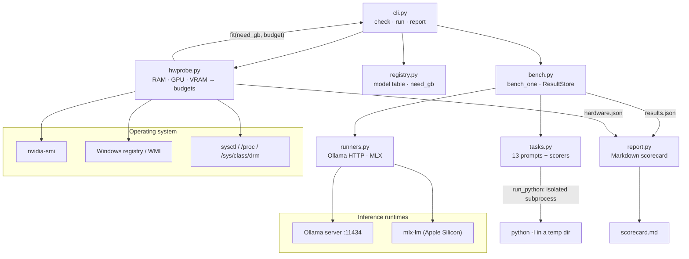

# Architecture

## System Diagram

## Component Descriptions

### Hardware probe
- **Purpose**: Works out how much memory a model can use on this machine, on any OS.
- **Location**: `src/llm_bench/hwprobe.py`
- **Key responsibilities**:
  - Total RAM from `GlobalMemoryStatusEx` (via ctypes) on Windows, `sysctl hw.memsize` on macOS, and `/proc/meminfo` on Linux
  - GPU and VRAM from `nvidia-smi`, then the Windows display-adapter registry key (`HardwareInformation.qwMemorySize`), with WMI as the last resort
  - Two budgets: `fast_gb` (fits on the GPU) and `spill_gb` (fits if some layers move to the CPU)
  - `fit(need_gb, hw)` returns `fast`, `slow` or `no`

### Model registry
- **Purpose**: One table of models. Each row has the Ollama tag, MLX repo, vendor, architecture and total parameter count.
- **Location**: `src/llm_bench/registry.py`
- **Key responsibilities**: `Model.need_gb` estimates memory at 4-bit (0.6 GB per billion parameters plus 1.5 GB). Every fit verdict is based on this number.

### Runtimes
- **Purpose**: The same `run(target, prompt) -> Generation` call for two very different backends.
- **Location**: `src/llm_bench/runners.py`
- **Key responsibilities**:
  - Ollama through its HTTP API. Timings come from the nanosecond counters in the response, and resident memory from `/api/ps`.
  - MLX through `mlx_lm.stream_generate`. Time to first token is measured on the stream, and peak memory comes from `mx.get_peak_memory()`.
  - Download checks: which Ollama tags are pulled (asking the server first, then the CLI), and which MLX models have complete weights in the Hugging Face cache
  - `strip_thinking()` removes reasoning blocks before scoring

### Task suite
- **Purpose**: 13 prompts in five categories, each with a fixed scoring function that returns a number from 0 to 1.
- **Location**: `src/llm_bench/tasks.py`
- **Key responsibilities**: run generated code against hidden asserts (`run_python`), match numbers exactly, check the last line for reasoning answers, find one sentence hidden in a generated 9,000-word document, and validate JSON and bullet formatting.

### Benchmark loop and storage
- **Purpose**: Runs every task for each chosen model and runtime, and totals the results.
- **Location**: `src/llm_bench/bench.py`
- **Key responsibilities**: averages per category; the worst load time, time to first token and peak memory; mean throughput. `ResultStore` replaces a model's row when it is run again, and saves after every model.

### Scorecard
- **Purpose**: Turns results into a readable comparison.
- **Location**: `src/llm_bench/report.py`
- **Key responsibilities**: overall ranking (70% quality, 30% speed, with speed capped at 80 tok/s), quality per category, a performance table, the best model on each measure, and MLX against Ollama for the same model.

## Data Flow

1. `llm-bench check` probes the hardware, saves `hardware.json`, asks Ollama which models are pulled, and prints each model's estimated memory, verdict and pull command.
2. `llm-bench run` picks the runtime (MLX and Ollama on Apple Silicon with mlx-lm installed, Ollama everywhere else) and selects the downloaded models that fit.
3. For each model, every task prompt goes to the runtime. The reasoning block is removed from the reply, the answer is scored, and timings and memory are recorded.
4. The model's row is written to `results.json` straight away, so stopping a run part way keeps the models that finished.
5. `report.py` builds `scorecard.md` from `results.json` and `hardware.json`.

## External Integrations

| Service | Purpose | Notes |
|---------|---------|-------|
| Ollama | Runs models on every OS | Local HTTP API on port 11434. Respects `OLLAMA_HOST`. No authentication. |
| Hugging Face cache | MLX model weights | Only checks whether weights are present. Respects `HF_HUB_CACHE` and `HF_HOME`. The user does the downloading. |
| `nvidia-smi`, registry, WMI, `sysctl` | Hardware facts | Each probe returns zero or None on failure instead of raising. |

## Key Architectural Decisions

### Fixed scoring instead of a judge model
- **Context**: Scores need to be comparable across machines and across runs.
- **Decision**: Every task is checked by code: run the generated program, match a number, or check the format.
- **Rationale**: A judge model adds its own randomness and cost, and tends to reward longer answers. The price is a narrower set of tasks (nothing like essay quality), which I accepted so that results repeat exactly.

### Two memory budgets instead of one
- **Context**: "Does it fit?" has a different answer on a graphics card than on a Mac's shared memory. Ollama can split a model between VRAM and system RAM, which works but is several times slower.
- **Decision**: Track `fast_gb` and `spill_gb`, which gives three verdicts.
- **Rationale**: With a single threshold, the tool would either hide models that run acceptably with offload or recommend ones that crawl. On Apple Silicon the two budgets are the same, because there is no slower memory to spill into.

### The registry key instead of WMI for Windows VRAM
- **Context**: The usual Windows API, `Win32_VideoController.AdapterRAM`, is a 32-bit field. It never reports more than 4 GB, so it gets nearly every modern GPU wrong.
- **Decision**: Try `nvidia-smi` first, then the display-adapter registry key's 64-bit `qwMemorySize`, and only then WMI, with a note when WMI was used.
- **Rationale**: A wrong VRAM figure means wrong recommendations. Reading the registry needs no extra package, and keeping WMI as a fallback means older drivers still give an answer.

### Standard library for detection, runtimes loaded only when used
- **Context**: The tool has to install cleanly on a fresh Windows Python and import on machines with no GPU software.
- **Decision**: `hwprobe.py` uses only the standard library (`ctypes`, `winreg`, `subprocess`). `mlx` and `httpx` are imported inside the functions that need them.
- **Rationale**: `check` works before anything else is set up, and the package imports on Windows, where MLX can't be installed at all.

### Containing generated code instead of sandboxing it
- **Context**: The coding tasks only mean something if the generated code actually runs.
- **Decision**: `run_python` writes the code to a private temporary folder, runs `python -I` there with a time limit, and deletes the folder afterwards.
- **Rationale**: A real sandbox (containers, seccomp) would make Windows setup much harder. Isolated mode and a throwaway folder prevent accidental damage, and the README says plainly that this is not a security boundary.
