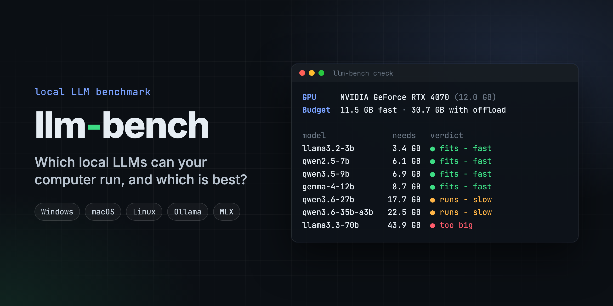

<p align="center">
  
</p>

# llm-bench

Find out which local LLMs your computer can run, then measure how good and how fast they are on it.

`llm-bench` reads your hardware (GPU memory, unified memory on Apple Silicon,
system RAM) and tells you which open-weight models will fit. Then it
benchmarks the ones you have downloaded on quality, speed and memory.

Quality is scored by code, not by another model. Generated code runs against
hidden tests, math answers are matched exactly, long-context recall is tested
by hiding one sentence in a 9,000-word document, and instruction-following is
checked against the required format.

It runs on Windows, macOS and Linux through [Ollama](https://ollama.com), and
also through [MLX](https://github.com/ml-explore/mlx) on Apple Silicon Macs.

## Features

- `llm-bench check` finds your GPU and how much memory it really has, using
  `nvidia-smi`, the Windows display-driver registry, `sysctl` on macOS, or
  `/sys/class/drm` for AMD on Linux. It sorts every model into *fits - fast*,
  *runs - slow (CPU offload)* or *too big*, and prints the `ollama pull`
  command for each one worth downloading.
- 13 tasks across coding, math, reasoning, long context and
  instruction-following, each scored by a fixed check. Running the same model
  twice gives the same score.
- Reasoning models are graded on their answer, not their working. The
  `<think>` block (and Gemma's equivalent) is removed before scoring.
- Load time, time to first token, prompt and generation speed, and the
  measured peak memory of every model.
- On a Mac, the same model can run through both MLX and Ollama, and the
  scorecard puts the two side by side.
- A Markdown scorecard: overall ranking (70% quality, 30% speed), quality per
  category, performance, and the best model on each measure.

## Sample results

Apple M4 Pro, 24 GB unified memory, MLX runtime:

| Rank | Model | Quality | Coding | Math | Reasoning | Gen tok/s | Peak memory (est. → measured) | Composite |
|---|---|---|---|---|---|---|---|---|
| 1 | phi4-mini | **77%** | 100% | 75% | 67% | 97 | 3.8 → 4.3 GB | 0.839 |
| 2 | qwen2.5-7b | **85%** | 67% | 100% | 67% | 61 | 6.1 → 5.7 GB | 0.825 |
| 3 | llama3.2-3b | **62%** | 67% | 50% | 33% | 102 | 3.4 → 3.8 GB | 0.734 |

Qwen2.5 7B gives the best answers, but Phi-4 mini ranks first because it is
60% faster for eight points less quality. For all three models, the memory
estimate that `check` uses was within 0.5 GB of the measured peak.

## Getting started

### Prerequisites

- Python 3.10 or newer
- [Ollama](https://ollama.com/download) (required on Windows and Linux, optional on a Mac)
- On Apple Silicon, optionally the MLX runtime: `pip install -e ".[mlx]"`

### Windows

1. Install Python 3.10 or newer from
   [python.org](https://www.python.org/downloads/windows/). In the installer,
   tick "Add python.exe to PATH".
2. Install Ollama from [ollama.com/download](https://ollama.com/download) and
   start it. It runs in the system tray.
3. In PowerShell, from a clone of this repo:

   ```powershell
   python -m venv .venv
   .venv\Scripts\Activate.ps1
   pip install -e .
   llm-bench check
   ```

   If PowerShell refuses to run `Activate.ps1`, run
   `Set-ExecutionPolicy -Scope CurrentUser RemoteSigned` once, or skip
   activation and call `.venv\Scripts\llm-bench.exe` directly.
4. Pull a model that `check` marks as fitting, then run the benchmark:

   ```powershell
   ollama pull qwen2.5:7b
   llm-bench run
   ```

### macOS

```bash
python3 -m venv .venv && source .venv/bin/activate
pip install -e ".[mlx]"        # leave off [mlx] on an Intel Mac
llm-bench check
huggingface-cli download mlx-community/Qwen2.5-7B-Instruct-4bit   # or: ollama pull qwen2.5:7b
llm-bench run
```

### Linux

Same as macOS, without `[mlx]`. NVIDIA GPUs are read through `nvidia-smi` and
AMD GPUs through `/sys/class/drm`.

## Usage

```bash
llm-bench check                          # this machine's budget and which models fit; runs nothing
llm-bench run                            # every downloaded model that fits on the GPU
llm-bench run --include-slow             # also the ones that need CPU offload
llm-bench run --models qwen2.5-7b,phi4-mini
llm-bench run --runtime ollama           # auto | ollama | mlx | both
llm-bench report                         # rebuild the scorecard from saved results
```

Results go to `./llm-bench-results/` (change it with `--out`). `results.json`
keeps every model you have run, so you can benchmark a few at a time, and
`scorecard.md` is rewritten after each run.

### How "fits" is decided

| Machine | Fast budget | With CPU offload |
|---|---|---|
| Apple Silicon | The GPU's share of unified memory (about 66%, or 75% above 36 GB), minus 2 GB for macOS | Same. There is no slower memory to fall back on |
| NVIDIA or AMD graphics card | VRAM minus 0.5 GB | VRAM plus 60% of system RAM |
| No usable GPU | 0 | 60% of system RAM |

A model's memory need is estimated for 4-bit weights: about 0.6 GB per
billion parameters, plus 1.5 GB for context and the runtime. Every run also
records the real peak, so the scorecard shows whether the estimate held.

### Windows notes

- NVIDIA cards work best. Ollama uses CUDA automatically, and `nvidia-smi`
  reports VRAM exactly.
- AMD Radeon: Ollama uses the GPU on supported recent Radeon cards and falls
  back to the CPU on others. `check` adds a note when it finds an AMD GPU.
- Intel GPUs (Arc, Iris, UHD) are not accelerated by the standard Ollama build.
- VRAM is read from the display-driver registry key, which stores the full
  size. If that key can't be read, the tool falls back to WMI, which never
  reports more than 4 GB, and prints a note saying so.
- MLX only exists on Apple Silicon, so every Windows result comes from Ollama.
- Laptops slow down on battery. Plug in if you want numbers you can compare.

## Customising

- Models: add a row to the table in [`src/llm_bench/registry.py`](src/llm_bench/registry.py)
  with the Ollama tag, MLX repo and parameter count.
- Tasks: add to `TASKS` in [`src/llm_bench/tasks.py`](src/llm_bench/tasks.py).
  Each task is a prompt plus a function that scores the reply from 0 to 1.
- Ranking: the quality and speed weights are at the top of
  [`src/llm_bench/report.py`](src/llm_bench/report.py).

## Safety

The coding tasks run code that the model wrote, because that is how they are
scored. The code runs in a temporary folder that is deleted afterwards, in
Python's isolated mode, with a time limit. That stops accidents, but it is not
a sandbox: the code runs with your user's permissions. Stick to models from
sources you trust (the registry only lists well-known open-weight models), or
use a VM or container for anything else.

## Development

```bash
pip install -e ".[dev]"
pytest                      # runs offline: no GPU, model or Ollama needed
ruff check src tests && ruff format --check src tests
```

CI runs the tests, the linter and a real `llm-bench check` on Windows, macOS
and Linux. Hardware the CI machines don't have (NVIDIA and AMD cards,
integrated graphics, a 4 GB WMI reading) is tested against recorded output
from those tools.

## Project structure

```
llm-bench/
├── src/llm_bench/
│   ├── cli.py         # the check, run and report commands
│   ├── hwprobe.py     # RAM, GPU and VRAM detection, memory budgets, fit verdicts
│   ├── registry.py    # the model table and the memory estimate
│   ├── runners.py     # Ollama (HTTP) and MLX adapters, download checks
│   ├── tasks.py       # the 13 tasks and how each is scored
│   ├── bench.py       # runs the tasks, totals scores and timings, saves results
│   └── report.py      # writes the Markdown scorecard
├── tests/             # offline tests, with a right and a wrong answer for every task
└── .github/workflows/ # CI on Windows, macOS and Linux
```

## License

[MIT](LICENSE)

## Author

Jacob Kanfer ([GitHub](https://github.com/Technical-1))
