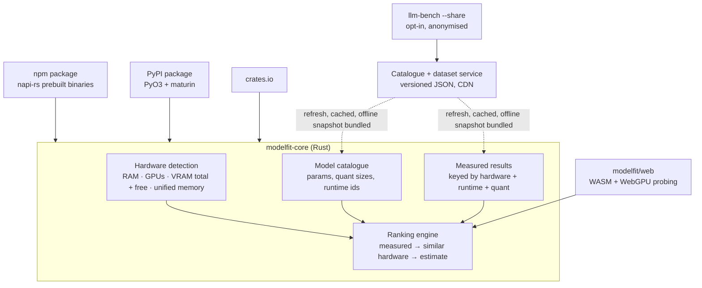

# modelfit: project plan

**Status:** draft, 2026-10-18. Nothing is built yet. Phase 0 decides whether to build.

## 1. The idea in one paragraph

Apps are starting to ship local AI models. Every one of them faces the same
question at install time: which model should *this user's* machine run? Today
they hard-code one model (too big for half their users, wasted on the other
half) or make the user choose (most users can't). `modelfit` is a one-call
library that answers it. The developer passes a shortlist of models their app
supports; `modelfit` reads the machine and returns the best one for it, with
the reason. It answers from **measured benchmark results** for that hardware
when they exist and from an **estimate** when they don't. Over time the
measured dataset, collected across every kind of computer, is the product.

## 2. Who it is for

| User | What they get |
|---|---|
| App developers bundling a local model (desktop, Electron/Tauri, CLI tools, browser apps) | One line instead of their own hardware detection and guesswork. Fewer "it's so slow" bug reports |
| Developers choosing which models to support | The dataset tells them which candidates cover which share of real machines |
| End users | The app just works on their machine, without them knowing what VRAM is |
| People running models themselves | The `llm-bench` CLI, and later a "what can I run" page powered by the same data |

## 3. The API (first sketch)

The whole public surface starts as one function. Same shape in every language.

```ts
// npm
import { pickModel } from "modelfit";

const choice = await pickModel({
  candidates: ["qwen3.5:9b", "gemma4:e4b", "llama3.2:3b"],
  prefer: "balanced",            // "quality" | "speed" | "balanced"
  minTokensPerSec: 20,           // never pick something that would feel sluggish
  contextTokens: 8192,           // memory depends on context length too
  runtime: "ollama",             // or "llama.cpp" | "mlx" | "webllm" | "auto"
});
// {
//   model: "gemma4:e4b",
//   verdict: "fast",                       // fast | slow | none-fit
//   expected: { tokensPerSec: 48, memoryGb: 6.3, quality: 0.81 },
//   source: "measured",                    // measured | similar-hardware | estimate
//   reason: "Fits in 11.5 GB of VRAM; measured 48 tok/s on 212 machines with an RTX 4070",
//   ranked: [ ...every candidate with its own verdict and numbers ]
// }
```

```rust
// crates.io
let choice = modelfit::pick(&Request::new(["qwen3.5:9b", "gemma4:e4b", "llama3.2:3b"])
    .prefer(Prefer::Balanced))?;
```

```python
# PyPI
from modelfit import pick_model
choice = pick_model(["qwen3.5:9b", "gemma4:e4b", "llama3.2:3b"], prefer="balanced")
```

Also exposed, for developers who want the parts: `detectHardware()` and
`estimate(model, hardware)`.

## 4. Architecture



**One Rust core, many packages.** Detection and ranking are written once in
Rust and shipped to npm (`napi-rs`), Python (`PyO3`/`maturin`) and crates.io.
This is how Ruff, SWC and Biome ship one engine to several ecosystems, and it
means the hardware detection behaves identically everywhere.

**Data is not code.** The model catalogue and the measured results are
versioned JSON served from a CDN. The package caches them and also ships an
offline snapshot, so a new model appearing next week needs a data update, not
a package release, and an app with no network still gets an answer.

**Building blocks in Rust:** `sysinfo` (RAM, CPU), `nvml-wrapper` (NVIDIA VRAM,
total and free), `wgpu` (enumerate GPUs on every OS), Windows registry via
`winreg` (true VRAM; WMI caps at 4 GB, already solved in `llm-bench`),
`sysctl`/IOKit on macOS (unified memory, GPU wired limit).

## 5. The hard parts (all in scope)

Each of these is a reason the product is worth building, not a reason to skip
it. Each has a first approach; Phase 0 tests the riskiest ones.

### 5.1 Browsers hide GPU memory
Browser apps (WebLLM, transformers.js) are a big share of apps that bundle
models, and browsers deliberately do not expose VRAM. WebGPU gives
`maxBufferSize` and `maxStorageBufferBindingSize`, not memory; `navigator.deviceMemory`
reports at most 8 GB; the adapter name may be hidden.
- **First approach:** a probing allocator. Allocate WebGPU buffers in growing
  steps until allocation fails or the device is lost, then release. Combine
  that ceiling with adapter info (when exposed) and the dataset's "machines
  with this adapter" figures.
- **Open:** how slow and how disruptive probing is, how it behaves on each
  browser and OS, whether it can be done once and cached per origin.

### 5.2 Models change weekly
- The catalogue is data (see §4). Each entry: family, total and active
  parameters, architecture (dense or MoE), available quantisations with real
  file sizes, and the id on each runtime.
- A catalogue builder pulls sizes from Ollama's library and Hugging Face so
  entries are generated, not typed.
- Developers can pass a model the catalogue doesn't know, with its parameter
  count; it gets an estimate-only answer.

### 5.3 The same model behaves differently per runtime and quant
`qwen2.5:7b` on Ollama, a Q4_K_M GGUF in llama.cpp and a 4-bit MLX build are
three different things for memory and speed.
- **Model identity:** a canonical id (`qwen2.5-7b-instruct`) plus a quant
  (`q4_k_m`, `mlx-4bit`) plus a runtime. Measured results are keyed on all three.
- A mapping table from each runtime's naming to the canonical id, generated
  with the catalogue.

### 5.4 Privacy of shared results
Developers will read this before putting `modelfit` in their app.
- Submitting is always opt-in and never happens from the library inside
  someone's app; it happens from `llm-bench --share` (and later an explicit API
  call a developer can choose to wire up).
- A submission holds hardware class (GPU model, VRAM, RAM, CPU model, OS
  family), runtime and version, model and quant, and the measured numbers.
  Never a hostname, username, serial, IP-derived id, or prompt.
- The submission is shown in full before it is sent.
- The library itself only *downloads* the dataset. It makes no network call
  that identifies the user.

### 5.5 Competition
Others may build parts of this, and runtimes (Ollama, LM Studio) could add a
"recommended for your machine" label.
- **Defence:** the cross-runtime measured dataset, plus being a library a
  developer embeds rather than an app a user opens. A runtime can't recommend
  across runtimes.
- Phase 0 starts with a real survey of what exists.

### 5.6 Hardware nobody has measured yet
Most machines won't have an exact match in the dataset.
- Fall back in order: same GPU and VRAM → same GPU family and memory tier →
  same memory budget on the same runtime → the estimate.
- The answer always says which source it used (`measured`, `similar-hardware`,
  `estimate`).

### 5.7 Free memory, not total memory
A user with a game or a browser full of tabs open doesn't have their full VRAM.
- Detect free VRAM where the platform reports it (NVML does; macOS gives
  memory pressure), and let the developer choose total or free.
- Context length changes the memory need (KV cache), so it's a parameter.

### 5.8 Bad or fake submissions
An open dataset can be gamed or polluted by broken runs.
- Each submission carries the full scorecard; outliers against the same
  hardware are held back until confirmed by others.
- Submissions are signed by the `llm-bench` version that produced them; only
  known versions are accepted. Rate-limited per client.

## 6. Phases

Every phase ends with a check that proves it, not a feeling.

### Phase 0: validate (before writing product code)
- Survey what exists: libraries, sites and runtime features that pick or
  recommend a model for hardware. Write `docs/research/landscape.md`.
- Get real `llm-bench` runs from Goose and 3 to 5 other machines (Windows +
  NVIDIA, Windows + AMD, an older Mac, a laptop on integrated graphics).
- Prototype the WebGPU probing allocator in a single HTML page; measure it on
  Chrome, Safari and Firefox on at least two machines.
- **Done when:** the landscape note exists and says whether this space is
  open; the estimate has been compared with measured peaks on real Windows
  GPUs; the browser probe either works on the major browsers or the note says
  why not.

### Phase 1: start collecting data
- Add `llm-bench run --share` (opt-in, shows the payload first).
- Pick the backend for submissions (open decision, §8).
- Define the result schema and the canonical model id (§5.3).
- **Done when:** a run from a second machine lands in the dataset and can be
  read back.

### Phase 2: modelfit-core in Rust
- Hardware detection on Windows, macOS, Linux (port and extend `llm-bench`'s
  `hwprobe`).
- Catalogue loader, ranking engine, `pick()`.
- A small `modelfit` CLI for testing (`modelfit pick qwen3.5:9b gemma4:e4b`).
- CI on all three OSes, like `llm-bench`.
- **Done when:** `pick()` gives the same answer as `llm-bench check` on the
  same machines, and uses measured data when the dataset has it.

### Phase 3: packages
- npm with prebuilt binaries for win-x64, win-arm64, mac-arm64, mac-x64,
  linux-x64, linux-arm64. PyPI wheels. crates.io.
- A demo app (Tauri or Electron) that picks and loads a model on first run.
- **Done when:** `npm install modelfit` and one call work on a fresh Windows
  and Mac with no build tools.

### Phase 4: catalogue and dataset service
- Generated catalogue, published as versioned JSON on a CDN, plus the offline
  snapshot in every package.
- **Done when:** adding a model to the catalogue reaches an installed package
  without a release.

### Phase 5: browser package
- `modelfit/web`: the WASM ranking engine plus the WebGPU probe.
- **Done when:** a WebLLM demo picks a model correctly on two browsers and two
  machines.

### Phase 6: public launch
- Docs site, a public "what can my computer run" page on the dataset,
  announcement.

## 7. Relationship to llm-bench

`llm-bench` (public, `Technical-1/local-llm-bench`) stays the benchmarking CLI
and becomes the **data collector**: `--share` sends its scorecards to the
dataset. Its hardware probe and memory estimate are the starting point for
`modelfit-core`. It already measured the estimate within 0.5 GB of the real
peak for three models on an M4 Pro, and its CI proves detection runs on real
Windows, macOS and Linux.

## 8. Open decisions

| Decision | Options | Leaning |
|---|---|---|
| Submission backend | Cloudflare Worker + D1 · Supabase · a GitHub repo of JSON files | Worker + D1: free tier, simple, no server to run |
| Licence | MIT · Apache-2.0 · MIT for code, a separate licence for the dataset | Code MIT; dataset licence decided before Phase 1 |
| Package name availability | `modelfit` on npm, PyPI, crates.io | Check in Phase 0, before anything is announced |
| Business model | Free library + paid hosted API / team dashboard · fully open | Decide after Phase 3 adoption numbers |
| Where the dataset lives long term | Public read · gated | Public read builds trust and adoption |

## 9. Risks

- **The dataset never grows.** Mitigation: `llm-bench` is useful by itself, so
  people run it for their own reasons; the "what can my computer run" page
  gives them a reason to share.
- **Estimates are wrong on hardware we can't test.** Mitigation: every answer
  states its source; CI covers detection; the community fills gaps.
- **Prebuilt native binaries are painful.** Mitigation: `napi-rs` and `maturin`
  are mature; budget real time for the release pipeline in Phase 3.
- **A runtime ships this first.** Mitigation: cross-runtime data and being
  embeddable are things a single runtime can't offer.
